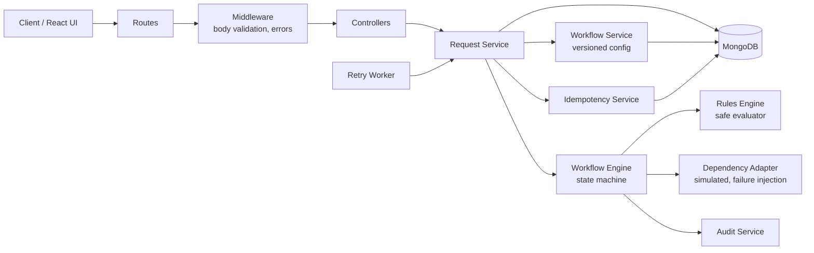
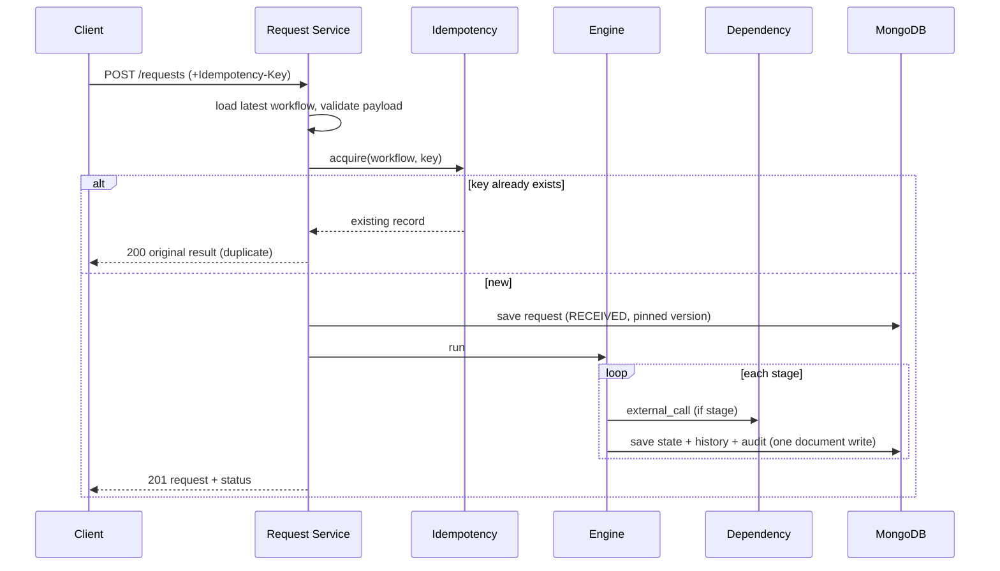

# Architecture

## 1. Problem structuring

**In scope:** intake and schema validation, rule evaluation, staged workflow execution (approve / reject / retry /
manual review), state lifecycle with history, explainable audit trail, idempotency, dependency failure handling,
configuration-driven behaviour.

**Out of scope (documented, not built):** authentication, multi-tenant isolation, a visual workflow designer,
distributed queues, real external integrations.

**Core idea:** separate *what the business wants* (workflow definition: data) from *how decisions are executed*
(engine: code). The engine knows five stage types and nothing about loans, vendors or claims.

## 2. Components

| Component | Responsibility | Depends on |
|---|---|---|
| Routes / Controllers | HTTP mapping only, no business rules | Services |
| Middleware | Body validation, uniform error shape, logging | none |
| Request Service | Orchestrates intake -> idempotency -> persist -> run; retry / review / recovery | Workflow, Idempotency, Engine, Models |
| Workflow Service | Loads YAML, validates, stores **immutable versions**, serves definitions | Models, Validator |
| Idempotency Service | Race-safe claim of a key via unique index | Model |
| Workflow Engine | Runs stages, transitions state, writes history and audit | Rules Engine, Adapter, Audit |
| Rules Engine | Evaluates rules and returns a per-rule trace; **no `eval`** | none |
| Dependency Adapter | Simulated credit bureau / KYC with timeout and failure injection | none |
| Retry Worker | Polls due retries and stuck requests | Request Service |

Coupling is one-directional (controllers -> services -> engine -> pure helpers). The engine and rules engine have no
database imports, so they are unit-testable on plain objects (`tests/workflowEngine.test.js`).

## 3. Configuration model

A workflow is a document: `schema` (JSON Schema for intake), `start`, and `stages`.

| Stage type | Config | Behaviour |
|---|---|---|
| `rules` | `rules[]`, `next` | Rules run in order. All pass -> `next`. First failure -> that rule's `on_fail` stage |
| `branch` | `branches[]` (rule-shaped condition + `next`), `default` | Conditional routing on the passing path: first matching branch wins, otherwise `default`. Every evaluated condition is traced |
| `external_call` | `service`, `max_attempts`, `backoff_ms`, `timeout_ms`, `next`, `on_exhausted` | Success stores output in context. Failure -> `RETRY_PENDING` with exponential backoff; after `max_attempts` -> `on_exhausted` |
| `manual_review` | none | Parks the request until `POST /review` |
| `terminal` | `outcome: APPROVED \| REJECTED` | Final decision |

Rules are structured (`{id, field, op, value, on_fail}` with ops `eq neq gt gte lt lte in exists`), expressions
(`expr: "loan_amount <= income * 5"`, parsed by a small recursive-descent parser) or composites (`all`, `any`, `not`).
Rules can read the request payload and the outputs of earlier stages (`credit_check.score`).

**Changing requirements:** edit a threshold, add a stage, or re-route a failure in YAML, or `POST /api/workflows` with a
new `version`. Definitions are validated on load (unknown stages, bad expressions, unknown services, missing terminals),
so a bad config is rejected instead of activated. A new use case is a new file: `vendor_approval.yaml` and `claim_processing.yaml` required no engine code.

**Graph validation at load time:** besides references and expressions, the validator builds the stage graph and rejects cycles, stages unreachable from `start`, and a `manual_review` stage without both an `APPROVED` and a `REJECTED` terminal. The runtime step limit remains as a second line of defence. A retry is not a cycle: it is a state (`RETRY_PENDING`) on the same stage.

## 4. Data flow

## 5. State model

`RECEIVED -> IN_PROGRESS -> (RETRY_PENDING <-> IN_PROGRESS) -> MANUAL_REVIEW -> IN_PROGRESS -> APPROVED | REJECTED`

Every transition appends `{from, to, fromStage, toStage, reason, at}` to `stateHistory`.

## 6. Failure handling and consistency

| Failure | Handling |
|---|---|
| Invalid input | JSON Schema from workflow config -> 400 with field-level details; unsafe Mongo keys rejected |
| Duplicate request | Unique index on `(workflow, key)`; key = client `Idempotency-Key` or hash of workflow+payload. Original result returned (200 + `Idempotent-Replay`). Same key with different payload -> 422 |
| Concurrent duplicates | Only the insert winner proceeds; others read the winner's record. Request `_id` is pre-assigned and unique |
| Dependency failure / timeout | Adapter timeout -> `DEPENDENCY_FAILURE` audit entry -> `RETRY_PENDING` with exponential backoff -> worker or `POST /retry` -> after `max_attempts`, `on_exhausted` (manual review) |
| Concurrent retries / reviews | Atomic claim `findOneAndUpdate({status: expected} -> IN_PROGRESS)`; only one caller wins, others get 409 |
| Partial save failure | State, history and audit are in **one document**, so each step is a single atomic write. If the process dies between "key claimed" and "request saved", the next duplicate finds the orphan key and completes creation. If it dies mid-run, the request stays `IN_PROGRESS` and the worker resumes it from the persisted stage |
| Optimistic concurrency | Mongoose version key; conflicts surface as 409 |
| Misconfigured cycles | Rejected when the workflow is loaded (graph check); engine step limit (50) as a runtime backstop |
| Simulation hooks abused | `mock_*` / `simulate_failure` payload fields are rejected with 400 and ignored by the adapters unless `SIMULATION_MODE=true` |
| Rule that cannot be evaluated | Counts as **failed**, never silently passed |

## 7. Explainability and audit

Each step appends an audit entry. Rule evaluations store a trace per rule: rule id, description, field or expression,
actual value, expected value, result and a plain-language reason, plus a data reference (input values and payload hash).
`GET /requests/:id/explanation` turns this into a summary and step list. Requests also store `workflowVersion`, so every
decision can be reproduced against the exact rules that made it. See `docs/decision_examples.md`.

## 8. Trade-offs

| Decision | Why | Cost / alternative |
|---|---|---|
| Custom rules engine instead of a library | Small, safe (no `eval`), fully traceable, easy to defend | Less expressive; a library (json-rules-engine) suits very large rule sets |
| State + history + audit in one Mongo document | Atomic per-step writes without multi-document transactions or a replica set | Unbounded array growth; at scale move audit to its own collection (append-only) |
| Pin workflow version per request | Rule changes never alter in-flight requests; decisions are reproducible | Old versions must be retained |
| Immutable versions | Audit integrity | Fix = publish a new version |
| Synchronous execution in the request | Simple, immediate result | Long dependencies block the HTTP call; the `RETRY_PENDING` path already moves slow work out of band |
| Polling retry worker in-process | No extra infrastructure | At scale: queue + worker pool |
| Mongo unique index for idempotency | Correct under concurrency without locks | Keys accumulate; add a TTL index in production |
| Stop at first failing rule in a stage | Clear, short audit story | Does not report *all* violations at once |

## 9. Assumptions
- One workflow definition per business use case; the latest active version applies to new requests.
- Payload contents are structured JSON; PII handling and encryption are out of scope.
- The external dependency is simulated (credit bureau, KYC, fraud screening); test hooks in the payload are a simulation aid and are disabled with `SIMULATION_MODE=false`; real adapters implement the same `call(service, {payload, attempt, timeoutMs})` contract.
- Manual reviewers are identified by a name string; authentication is out of scope.
- Duplicate detection without a key assumes identical payload means the same logical request.

## 10. Scaling considerations
- **API tier:** stateless, scale horizontally behind a load balancer.
- **Database:** MongoDB replica set; shard by request `_id`. Index on `{status, nextRetryAt}` already supports the retry poll.
- **Audit:** move to a separate append-only collection (or object storage/stream) to avoid large documents and allow retention policies.
- **Execution:** put intake behind a queue (Kafka/SQS), process in worker pools, make external calls fully asynchronous; keep the atomic-claim pattern for exactly-once stage execution.
- **Retries:** replace the polling loop with delayed queue messages and add a dead-letter queue.
- **Dependencies:** circuit breaker, per-service rate limits and bulkheads so one slow provider cannot exhaust workers.
- **Config:** cache compiled schemas and definitions (already cached per version for schemas); invalidate on new version.
- **Idempotency keys:** TTL index (e.g. 24 h to 7 days).
- **Observability:** correlation id per request, metrics (decision counts, retry rates, dependency latency), alerts on `RETRY_PENDING` backlog.
- **Security (future):** authN/Z, per-role manual review permissions, payload encryption.

## 11. Known limitations
- No authentication or authorization.
- Rules evaluate at stage level; no parallel stages or sub-workflows.